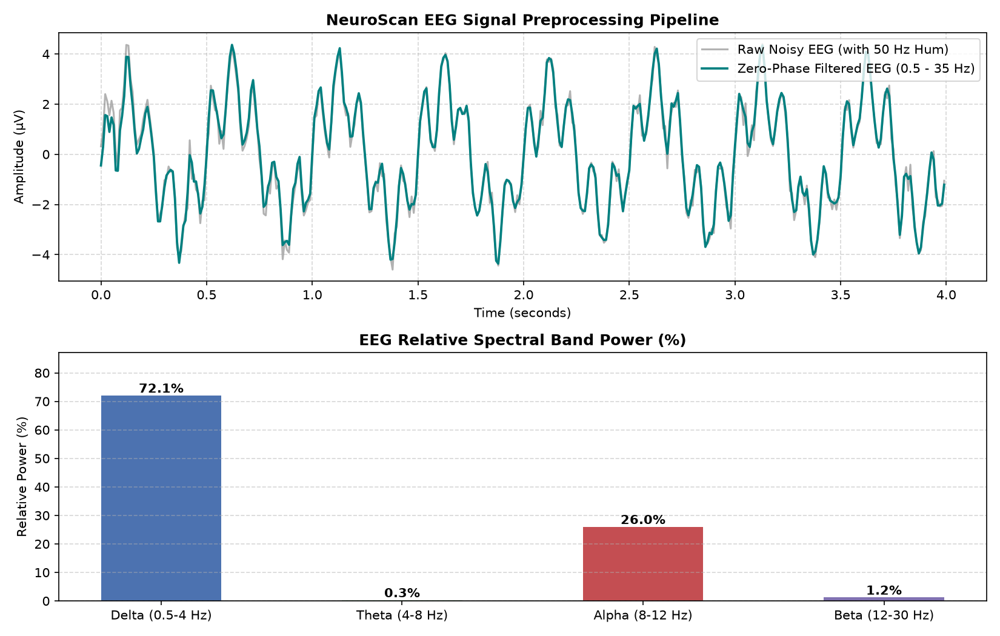
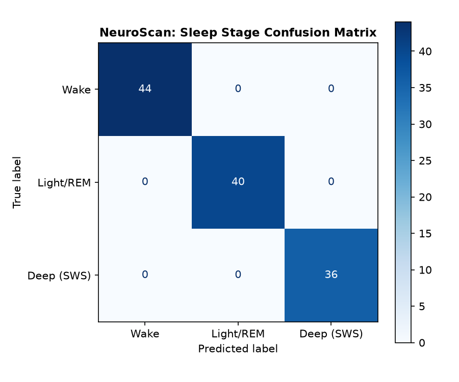
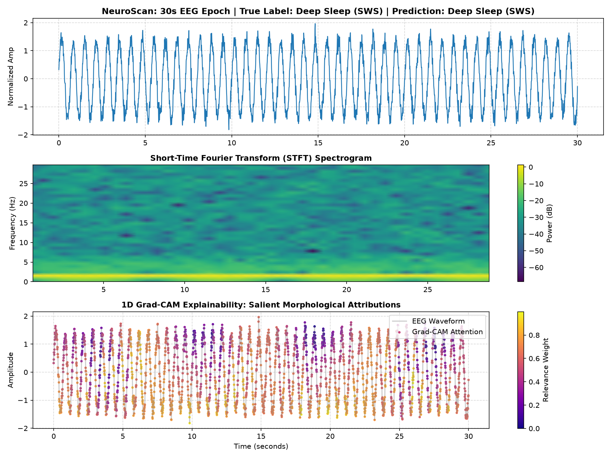

# NeuroScan: Explainable AI & Deep Learning for EEG Sleep Staging

[](https://www.python.org/)
[](https://pytorch.org/)
[](https://scipy.org/)
[](https://mne.tools/)
[](LICENSE)

An end-to-end Biomedical Signal Processing (DSP), Hybrid Deep Learning (CRNN), and Explainable AI (XAI) pipeline for automated sleep stage classification from multichannel/single-channel electroencephalogram (EEG) recordings. 

The architecture pairs spectral decomposition with a unified 1D-CNN + Bidirectional LSTM (CRNN) network, complemented by Time-Frequency Spectrograms and 1D Grad-CAM attributions to decode sleep micro-events.

---

## Key Highlights

- **Biomedical DSP & Spectral Power Analysis:**
  - Zero-phase 4th-order Butterworth bandpass filter ($0.5 - 35\text{ Hz}$) targeting physiological rhythms.
  - IIR Notch filter ($50\text{ Hz}$) suppressing electrical grid interference.
  - Quantitative band power computation ($\delta, \theta, \alpha, \beta$) via Welch's Power Spectral Density (PSD).
- **Hybrid CRNN Architecture (1D-CNN + BiLSTM):**
  - **1D-CNN Feature Extractor:** Multi-scale receptive fields capturing short transients (sleep spindles, K-complexes, delta waves).
  - **Bidirectional LSTM (BiLSTM):** Models bidirectional temporal dependencies across 30-second sleep epochs (3,000 samples @ 100 Hz).
- **Time-Frequency & Explainability Framework:**
  - Short-Time Fourier Transform (STFT) spectrogram mapping power shifts across sleep stages.
  - 1D Grad-CAM saliency heatmaps highlighting temporal features driving classification.

---

## Visual Pipeline & Results

### 1. Digital Signal Preprocessing & Relative Band Power
Noise-filtered baseline-corrected EEG signal alongside relative spectral band power distribution across canonical brainwave bands ($\delta, \theta, \alpha, \beta$).



### 2. Multi-Class Model Evaluation
Validation performance and class-wise discrimination metrics across sleep stages (Wake, Light/REM, Deep SWS).



### 3. Explainability: Spectrogram & 1D Grad-CAM Saliency
Three-tier visualization showing the raw epoch, STFT power density, and Grad-CAM relevancy weights localized on slow-wave delta oscillations.



---

## Model Architecture

| Component | Layer Type | Details / Hyperparameters | Output Shape |
|---|---|---|---|
| **Input** | EEG Epoch Tensor | Single Channel (30s @ 100 Hz) | `(Batch, 1, 3000)` |
| **Conv Block 1** | Conv1D + BN + ReLU + MaxPool | $K=15, S=2, C_{\text{out}}=16$ | `(Batch, 16, 375)` |
| **Conv Block 2** | Conv1D + BN + ReLU + MaxPool | $K=7, S=1, C_{\text{out}}=32$ | `(Batch, 32, 93)` |
| **Conv Block 3** | Conv1D + BN + ReLU + MaxPool | $K=3, S=1, C_{\text{out}}=64$ | `(Batch, 64, 46)` |
| **Sequence Model** | Bidirectional LSTM | Hidden Units $= 64$, Layers $= 1$ | `(Batch, 46, 128)` |
| **Pooling** | Global Average Pooling | Mean across sequence length | `(Batch, 128)` |
| **Head** | Linear + ReLU + Dropout(0.3) + Linear | Latent $= 32 \to 3$ classes | `(Batch, 3)` |

---

## Installation & Usage

1. **Clone the repository:**
   ```bash
   git clone [https://github.com/nintaras/NeuroScan.git](https://github.com/nintaras/NeuroScan.git)
   cd NeuroScan

Set up virtual environment:
python3 -m venv venv
source venv/bin/activate
pip install -r requirements.txt

Verify DSP and band power pipeline:
python3 test_dsp.py

Train the Hybrid CRNN:
python3 train.py

Generate Spectrogram & Grad-CAM explanations:
python3 explain.py


References
Kemp, B., et al. Analysis of a sleep-dependent neuronal feedback loop: the slow-wave interruption. IEEE Transactions on Biomedical Engineering (2000).
Iber, C., et al. The AASM Manual for the Scoring of Sleep and Associated Events. American Academy of Sleep Medicine (2007).
Selvaraju, R. R., et al. Grad-CAM: Visual Explanations from Deep Networks via Gradient-Based Localization. ICCV (2017).

License
Distributed under the MIT License.